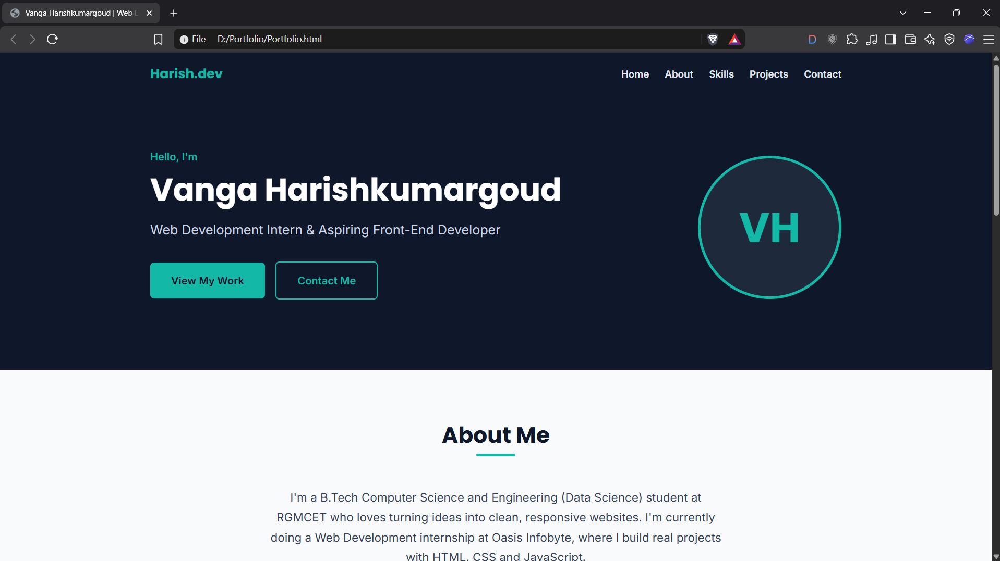
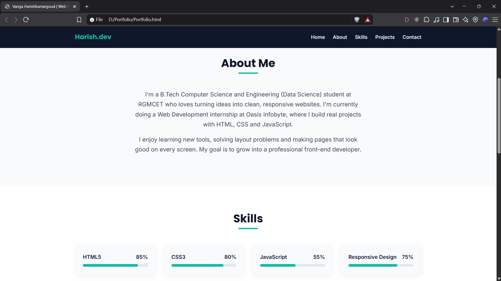
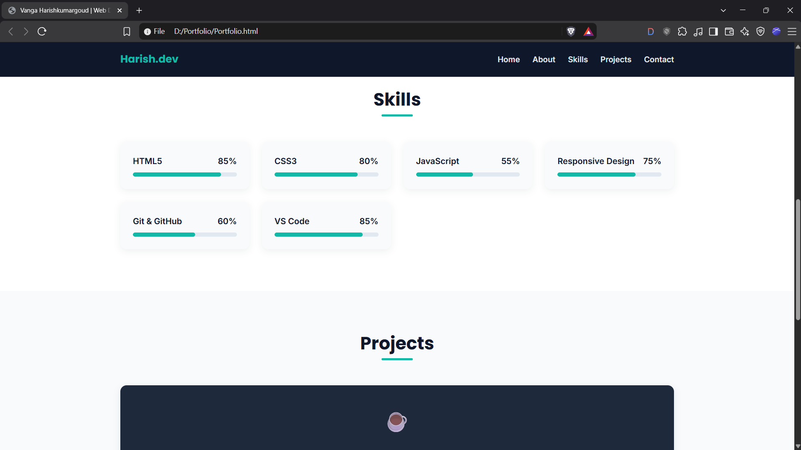
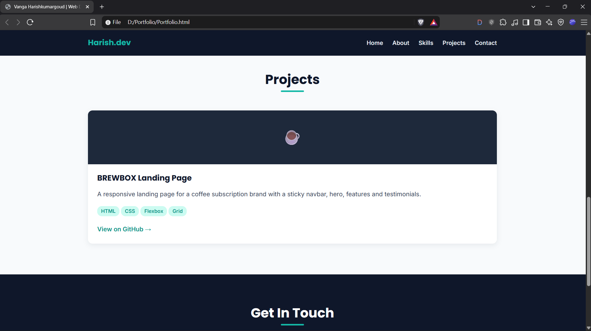
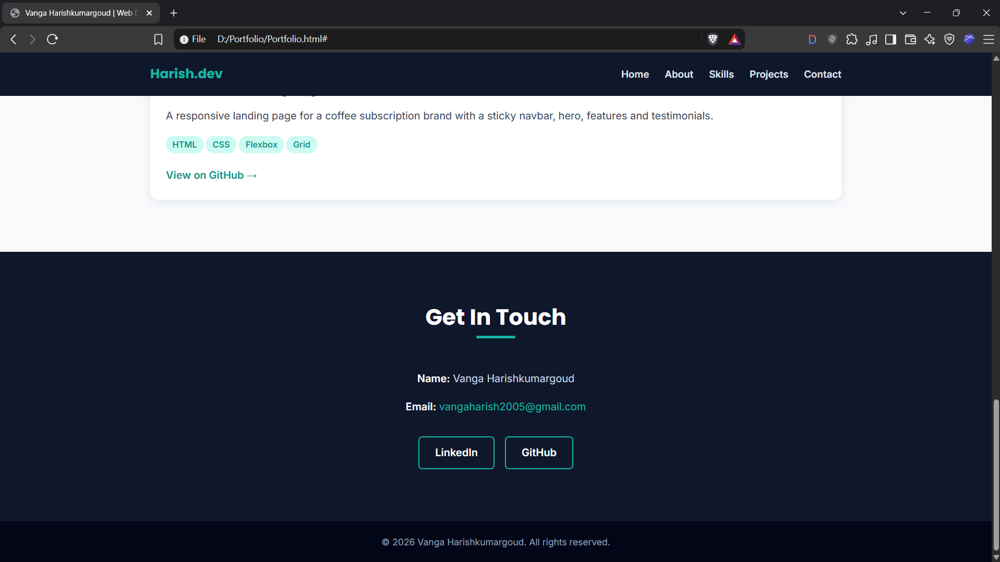

# Personal Portfolio Website

A responsive personal portfolio showcasing my skills, projects and contact information.
Built for the Web Development Internship at **Oasis Infobyte** (#oasisinfobyte).

## Author

**Vanga Harishkumargoud** - B.Tech CSE (Data Science), RGMCET
- Email: vangaharish2005@gmail.com
- LinkedIn: https://www.linkedin.com/in/harish-kumar-goud
- GitHub: https://github.com/harish-ux-BIT

## Tech Stack

- HTML5
- CSS3 (Flexbox, Grid, CSS variables)
- Google Fonts (Poppins, Inter)
- No JavaScript

## Features

- Sticky navigation bar with smooth scrolling between sections
- Hero section with name, role title and avatar placeholder
- About Me section
- Skills section with a grid of progress bars
- Projects section with project cards (title, description, tags, GitHub link)
- Contact section with email, LinkedIn and GitHub links
- Consistent navy and teal branding, fully responsive

## Folder Structure

```
WebDev-L1-Portfolio/
├── index.html
├── README.md
└── screenshots/
```

## How to Run

1. Download or clone the repository.
2. Open `index.html` in any modern web browser. No installation needed.

## Customising

- Edit the About Me text and the skill percentages (`style="width:..%"`).
- Replace the project cards and GitHub links with your own.
- For a real photo, add `photo.jpg` to the folder and replace the "VH" avatar text with an `` tag.

## Colour Palette

| Colour | Hex |
|---|---|
| Navy | `#0F172A` |
| Teal | `#14B8A6` |
| Background | `#F8FAFC` |
| Text | `#334155` |


## Screenshots











## Demo Video

LinkedIn post: _add link here_

&copy; 2026 Vanga Harishkumargoud
