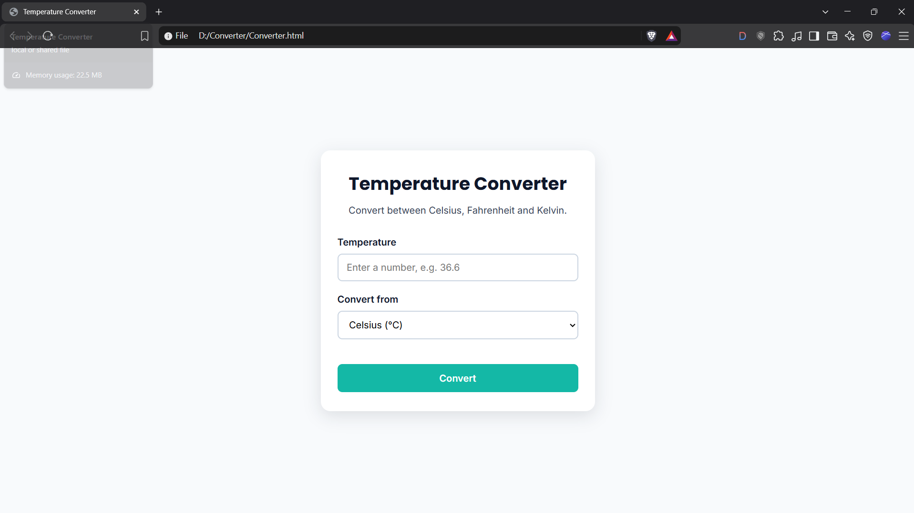
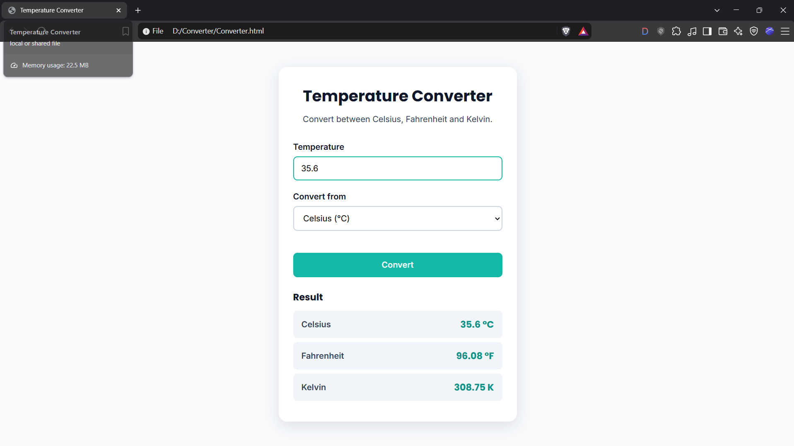

# Temperature Converter

An interactive web tool that converts temperatures between Celsius, Fahrenheit and Kelvin, with real-time input validation.
Built for the Web Development Internship at **Oasis Infobyte** (#oasisinfobyte).

## Author

**Vanga Harishkumargoud**
- Email: vangaharish2005@gmail.com
- LinkedIn: https://www.linkedin.com/in/harish-kumar-goud
- GitHub: https://github.com/harish-ux-BIT

## Tech Stack

- HTML5
- CSS3
- JavaScript (vanilla, no libraries)
- Google Fonts (Poppins, Inter)

## Features

- Numeric input with real-time validation (non-numeric input shows an error message and a red border)
- Dropdown to choose the input unit: Celsius, Fahrenheit or Kelvin
- Convert button (Enter key also works)
- Result card showing all three units at once, with unit labels
- Absolute zero check: values below 0 K (-273.15 °C / -459.67 °F) show a friendly error
- Results rounded to 2 decimal places
- Clean, centred and responsive layout

## Conversion Formulas

| Conversion | Formula |
|---|---|
| Celsius to Fahrenheit | F = C × 9/5 + 32 |
| Fahrenheit to Celsius | C = (F − 32) × 5/9 |
| Celsius to Kelvin | K = C + 273.15 |
| Kelvin to Celsius | C = K − 273.15 |

Every input is first converted to Kelvin, then to the other units.

## Folder Structure

```
WebDev-L1-TemperatureConverter/
├── index.html
├── README.md
└── screenshots/
```

## How to Run

1. Download or clone the repository.
2. Open `index.html` in any modern web browser.
3. Enter a value, choose the unit and click **Convert**.

## Test Cases

| Input | Expected output |
|---|---|
| 100 °C | 212 °F, 373.15 K |
| 32 °F | 0 °C, 273.15 K |
| 0 K | -273.15 °C, -459.67 °F |
| -300 °C | Absolute zero error message |
| abc | Invalid number error message |
| (empty) | "Please enter a temperature value" |


## Screenshots





## Demo Video

LinkedIn post: _add link here_

&copy; 2026 Vanga Harishkumargoud
